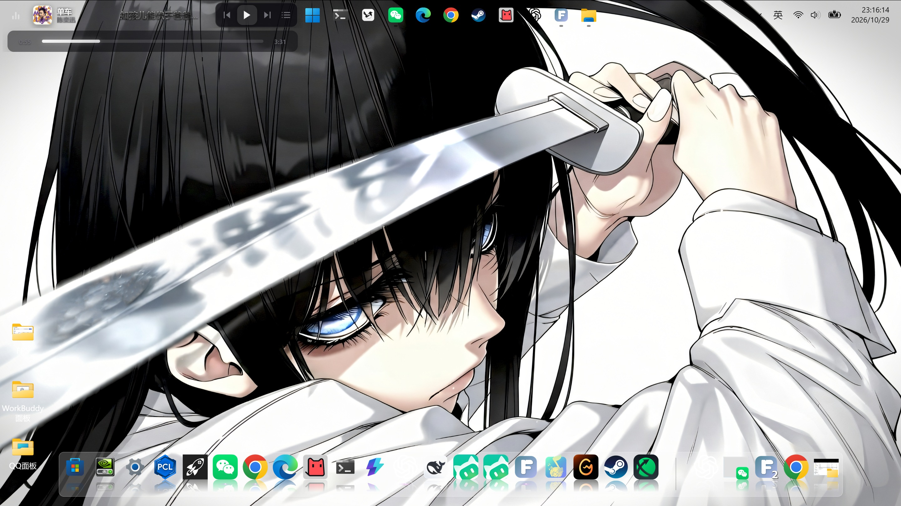

# 任务栏嵌入歌词（紧凑版）

将 Folia 的歌词、封面和播放控制嵌入 Windows 任务栏左侧空余区域。

## 特性

- 自动读取 Windows 任务栏位置，避开系统图标和任务按钮。
- 支持顶部、底部任务栏，以及宽度和左侧偏移调整。
- 提供透明贴靠模式，只保留封面、歌曲信息、歌词和播放控制。
- 支持逐字歌词、翻译和歌曲封面显示。
- 鼠标悬停时显示播放控制及实时进度条。
- 进度条跟随真实播放时间，支持点击和拖动跳转。
- 不修改 Explorer，不向系统任务栏注入窗口，只使用独立悬浮层。

## 兼容性

- Windows 10 / 11

- Folia `>=0.7.21 <0.8.0`

## 安装

模组已提交至 Folia 模组市场，当前正在等待“先行测试”渠道审核。

上架后可在 Folia 的模组市场中搜索并安装。审核期间也可以手动安装：

1. 下载本仓库并解压。
2. 将 `taskbar-lyrics-compact/taskbar-lyrics-compact` 文件夹复制到 `%APPDATA%\Folia\mods\taskbar-lyrics-compact`。
3. 打开 Folia 的“模组”面板，启用“任务栏嵌入歌词（紧凑版）”。

## 权限

- `runtime.playback`：读取当前歌曲、歌手、封面、歌词和播放进度。
- `playback.control`：播放、暂停、切歌、进度跳转及拖动进度条。

模组不会上传用户数据，也不会下载或执行远程代码。

## 来源与许可证

基于 [moneker/folium-taskbar-lyrics](https://github.com/moneker/folium-taskbar-lyrics) 修改，使用 MIT 许可证。

完整许可证见 [taskbar-lyrics-compact/LICENSE](taskbar-lyrics-compact/LICENSE)。
